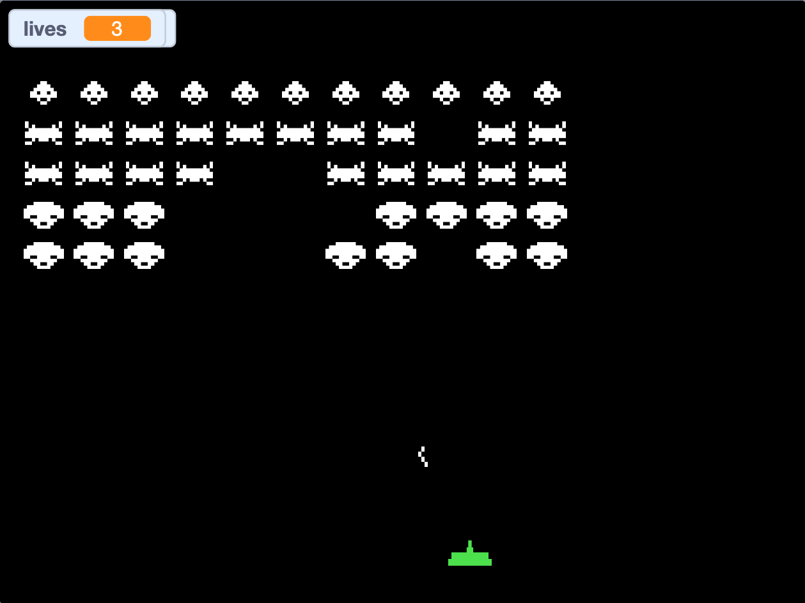

# Space Invaders for Scratch

A one-level remake of the 1978 arcade classic, written in
[goboscript](https://github.com/aspizu/goboscript) and compiled to a Scratch 3
project.

**Play it on Scratch:** https://scratch.mit.edu/projects/1380316326/



## How to play

- Click the green flag to start, and again to play another round.
- **Left / Right arrows** or **A / D** move the ship; **Space** fires.
- Only one shot can be on screen at a time.
- Clear all 55 invaders to win. You have 3 lives; you lose when they run out
  or when the invaders reach your ship.
- The fleet speeds up as it thins out — the last invader is fast.

| Target | Points |
|---|---|
| Top row | 30 |
| Middle two rows | 20 |
| Bottom two rows | 10 |
| Mystery UFO | 50, 100, 150 or 300 |

## Building from source

You need the goboscript compiler, which is installed with Cargo. From the
repository root:

```sh
cargo install --git https://github.com/aspizu/goboscript
goboscript build space_invaders -o space_invaders/space_invaders.sb3
```

Then open `space_invaders/space_invaders.sb3` in the
[Scratch editor](https://scratch.mit.edu/projects/editor/) with
**File → Load from your computer**. The `.sb3` is a build output and is not
checked in.

## Layout

| Path | Contents |
|---|---|
| `*.gs` | One goboscript file per sprite: `stage`, `player`, `bullet`, `invader`, `bomb`, `ufo` |
| `assets/` | Costumes, drawn as pixel-art SVG |
| `tools/` | A Python model of the formation arithmetic, with pytest tests |
| `docs/` | The design spec and the implementation plan the game was built from |

## How it works

The formation's position lives in two global variables, and the 55 invader
clones only render themselves from it — no clone ever decides where it is or
reports a wall hit. Edge detection, the lose line and kill detection are all
plain arithmetic over a 55-cell `grid` list plus per-row and per-column alive
counts. The bullet maps its own position to a grid cell instead of relying on
`touching`, which can tell you *that* a clone was hit but not *which* one.
The [design spec](docs/specs/2026-09-11-space-invaders-design.md) explains
the trade-offs.

The formation maths is checked by a small Python model. From the repository
root:

```sh
pip install pytest
pytest space_invaders/tools
```

## Not in this version

Destructible shields, sound, more waves and a saved high score. The
[plan's deferred list](docs/plans/2026-09-11-space-invaders.md#deferred)
tracks these along with known rough edges.

## Credits

- Inspired by *Space Invaders* (Taito, 1978), designed by Tomohiro Nishikado.
  This is an unofficial fan remake, not affiliated with Taito.
- Built with [goboscript](https://github.com/aspizu/goboscript) by aspizu.
- Made with the help of [Claude Code](https://claude.com/claude-code).

## License

[MIT](../LICENSE)
